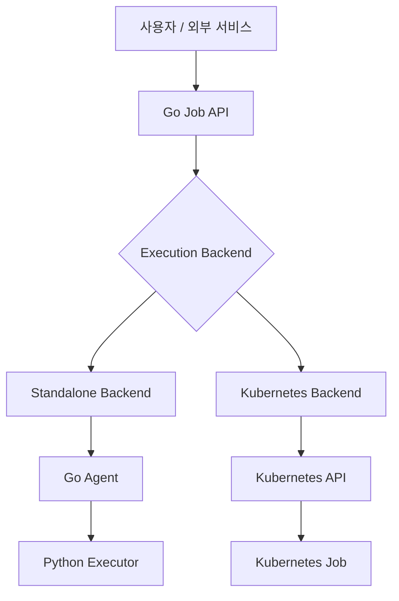

# Distributed Worker Platform

> **설계 단계 · 아직 실행 가능한 릴리스가 없습니다.**  
> **문서 기준선:** 설계 v1.0 (2026-10-18) · **프로젝트 상태:** Planning / Design

**Distributed Worker Platform**은 데이터 수집, 데이터 분석, AI 추론 등의 비동기 작업을 여러 실행 환경에서 일관되게 관리하기 위한 **분산 Job 오케스트레이션 플랫폼**입니다.

Kubernetes와 통합할 수 있도록 설계하지만, **Kubernetes 없이도 일반 Linux 서버의 Go Worker Agent를 통해 분산 실행**할 수 있습니다.

## 왜 만드는가?

장시간 실행되는 수집·분석·AI 작업은 API 응답과 분리하고, 작업별 자원 요구 및 실패 복구 정책을 적용할 필요가 있습니다. 또한 실행 환경을 Kubernetes로만 제한하면 VM·베어메탈 Linux 서버에 있는 기존 연산 자원을 활용하기 어렵습니다.

이 프로젝트는 하나의 Job API와 실행 모델을 유지하면서 **Standalone Process**와 **Kubernetes Job** 백엔드를 선택할 수 있는 구조를 목표로 합니다.

## 주요 기능 (계획)

- **공통 Job API:** 생성, 조회, 취소, Attempt 이력 및 결과 참조
- **Standalone 분산 실행:** Go Agent 등록, Capability/슬롯 기반 스케줄링, Redis Streams 전달
- **Kubernetes 실행:** Kubernetes Job 생성·관찰·취소, Pod 자원 요구/노드 조건 전달
- **Python Task Runtime:** 데이터 수집·분석·AI 모듈의 공통 실행 계약
- **장애 복구:** 재시도 정책, 멱등성, Lease/Fencing, Reconciliation
- **실행 추적:** Job/Attempt 상태 이력, 구조화 로그, Artifact URI

위 항목은 **개발 목표이며 현재 구현되거나 검증된 기능을 뜻하지 않습니다.**

## 실행 환경

| 항목 | Standalone | Kubernetes |
|---|---|---|
| 필요한 실행 기반 | Linux 서버/VM + Go Agent | Kubernetes 클러스터 |
| 실행 단위 | Python 자식 프로세스 | Kubernetes Job/Pod |
| Job 전달 | Redis Streams + Outbox | Kubernetes API + Reconciliation |
| 노드 배치 | 플랫폼의 Standalone Scheduler | kube-scheduler |
| 실행 모듈 | Python Task Runtime | 동일 Python Task Runtime(컨테이너) |
| 장애 복구 | Lease/Fencing/재전달 | Job/Pod 상태 관찰 + 업무 재시도 |

**Control Plane의 배포 환경과 Job 실행 환경은 독립적인 선택입니다.** 예를 들어 Docker Compose로 Controller를 운영하면서 Kubernetes에서 Job을 실행할 수 있도록 설계합니다.

## 아키텍처



### 역할 분리

- **Job Orchestrator (Go):** Job/Attempt, 백엔드 선택, 업무 재시도, 권한, 결과 관리
- **Standalone Backend:** Linux Worker 등록/스케줄링/메시지 전달
- **Go Agent:** 프로세스 생성·감시·취소, IPC/상태 보고
- **Kubernetes Backend:** Kubernetes Job API 연동 및 상태 조정
- **Python Task Runtime:** 환경에 관계없이 동일한 모듈 계약으로 실제 작업 수행

Kubernetes에서는 Pod 노드 배치를 자체 구현하지 않고 클러스터에 위임합니다.

## Job 실행 흐름

**Standalone**

1. Job을 생성하고 DB에 Attempt/Outbox를 저장합니다.
2. Scheduler가 적합한 Go Agent를 선택합니다.
3. Redis Streams를 통해 작업을 전달하고 Agent가 실행을 승인받습니다.
4. Agent가 Python 프로세스를 실행하며 JSONL IPC 이벤트를 수신합니다.
5. 결과/종료 코드를 검증하고 DB 상태를 확정한 뒤 Redis 메시지를 ACK합니다.

**Kubernetes**

1. 동일한 Job API로 Kubernetes 백엔드를 선택합니다.
2. 실행 의도와 Attempt를 DB에 저장합니다.
3. Kubernetes Adapter가 해당 Attempt의 Job을 생성·조회·조정합니다.
4. Kubernetes가 Pod를 스케줄링하고 Python 컨테이너가 작업을 실행합니다.
5. 플랫폼이 상태/결과를 수집하고 최종 Job/Attempt 상태를 확정합니다.

백엔드별 물리 동작은 다르지만 Job API, 상태 계약, 이력/결과 모델은 공통으로 유지하는 것이 목표입니다.

## Go Agent ↔ Python Executor 프로토콜 (Standalone)

초기 Standalone 실행 모델은 **Job당 독립 Python 프로세스**이며 `stdin/stdout`의 UTF-8 **JSON Lines(JSONL)**로 통신합니다. `stderr`는 일반 로그 전용입니다.

| 방향 | 이벤트 |
|---|---|
| Agent → Executor | `JOB_START`, `CANCEL` |
| Executor → Agent | `READY`, `JOB_ACCEPTED`, `PROGRESS`, `RESULT`, `ERROR`, `CANCEL_ACK`, `CANCELLED` |

```json
{
  "protocol_version": 1,
  "type": "JOB_START",
  "job_id": "job-001",
  "attempt_id": "attempt-001",
  "sequence": 1,
  "payload": {
    "module": "collector.stock_price",
    "params": {"symbol": "AAPL"},
    "timeout_seconds": 300
  }
}
```

이 JSON은 **설계 예시**이며 현재 실행 가능한 API 요청은 아닙니다.

Kubernetes 런타임에서는 표준 출력 IPC를 강제하지 않고 컨테이너 Entry Point, 인증된 결과 Callback, Artifact Store 등을 사용하도록 분리합니다.

## 기술 스택 (선정안)

| 역할 | 기술 |
|---|---|
| Job API / Orchestrator | Go |
| Linux Worker Agent | Go |
| 데이터 및 AI Task Runtime | Python |
| Standalone Job Dispatch | Redis Streams |
| 영구 상태 관리 | MariaDB |
| Artifact Storage | 로컬 파일 / S3 호환 스토리지(계획) |
| 배포 및 실행 기반 | Docker Compose, Linux VM, Kubernetes |

## 개발 로드맵

- [ ] **M0** — 요구사항, Job/Attempt 모델, 실행 프로토콜 기준선 확정
- [ ] **M1** — 로컬 Process Backend 및 테스트 Task 모듈 구현
- [ ] **M2** — 여러 Linux Agent의 분산 스케줄링 및 Redis Dispatch 구현
- [ ] **M3** — 장애 복구, 멱등성, Lease/Fencing 검증
- [ ] **M4** — Kubernetes Job Backend 구현
- [ ] **M5** — 동일 API로 Standalone/Kubernetes 통합 검증, 배포 문서 및 운영 관측성

향후 대상: GPU 정책 고도화, DAG Workflow, HA, CRD/Operator, 멀티 클러스터.

## 시작하기

> ⚠️ 프로젝트는 **설계 단계**입니다. 현재 저장소에는 실행 가능한 서버, Docker 이미지 또는 설치 스크립트가 준비되어 있다고 가정하지 않습니다.

최초 동작 가능한 프로토타입이 완성된 뒤 설치 요구사항, Docker Compose 실행 명령, Agent 설정, Kubernetes 매니페스트 및 기본 Job 실행 예제를 이 항목에 추가할 예정입니다.

## 저장소 구성 (예정)

```text
distributed-worker-platform/
├── cmd/                 # api, controller, agent 실행 진입점
├── internal/            # job, scheduler, backend, repository, recovery
├── executor/python/     # 공통 Python Task Runtime과 모듈
├── api/                 # API/프로토콜 스키마
├── migrations/          # DB 마이그레이션
├── deployments/         # compose / kubernetes 매니페스트
├── tests/               # Unit / Integration / Fault tests
├── docs/                # 설계/운영 문서(추후 정리)
└── README.md
```

## 설계상 주의 사항

- Redis의 HA와 Job 메시지/실행의 완전한 유실 방지는 동일한 문제가 아닙니다. DB Outbox와 복구 절차가 필요합니다.
- 동일 Job이 물리적으로 재실행될 수 있으므로 외부 데이터 쓰기에는 멱등성이 필요합니다.
- Process Backend는 신뢰 가능한 모듈 실행용이며 임의 코드 보안 샌드박스가 아닙니다.
- Kubernetes Job은 Pod 배치와 인프라 실행을 담당하며 플랫폼의 업무 수준 재시도/결과 판정과 역할이 다릅니다.
- 최초 설계에서는 Kubernetes CRD/Operator를 요구하지 않습니다.

## 기여 및 이슈

설계 단계이므로 기여 절차 및 개발 환경 실행 방법은 첫 번째 코드 릴리스와 함께 정식 안내할 예정입니다. 이슈 등록 시 재현 환경, 기대 동작, 실제 동작과 관련 로그(비밀값 제거)를 포함해 주세요.

## 라이선스

**라이선스 미선정.** `LICENSE` 파일과 라이선스 정책이 추가되기 전에는 공개 저장소라는 이유만으로 수정·재배포 권한이 자동 부여되지 않습니다. 라이선스 선정 후 이 항목을 갱신할 예정입니다.

## 문서 및 언어

기본 문서는 **한국어**입니다. 영문 `README.en.md`는 추후 필요에 따라 추가합니다. 상세 설계·요구사항·ADR 및 검증 기록은 프로젝트 Notion 문서에서 관리합니다.

## 참고 문서

- [Kubernetes Jobs](https://kubernetes.io/docs/concepts/workloads/controllers/job/)
- [Kubernetes: Assigning Pods to Nodes](https://kubernetes.io/docs/concepts/scheduling-eviction/assign-pod-node/)
- [Kubernetes Operator Pattern](https://kubernetes.io/docs/concepts/extend-kubernetes/operator/)
- [Redis Streams](https://redis.io/docs/latest/develop/data-types/streams/)
